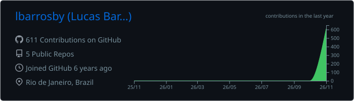
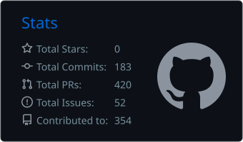
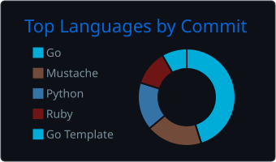

### Lucas Barros

  

Platform engineer based in Rio de Janeiro. I design and operate Kubernetes platforms for teams that ship to production every day, mostly in financial services.

Over the last years that meant running a fleet of 330 clusters behind ArgoCD, Atlantis and Rancher, turning EKS provisioning from a two-day manual process into a 40-minute Terraform/Terragrunt pipeline, moving a 3,000 jobs/day Jenkins farm to immutable infrastructure, and treating cloud cost as an engineering metric rather than a finance report.

I care about boring, predictable infrastructure: everything in code, every change reviewed, upgrades that nobody notices.

**Open source**

Contributing upstream across the cloud native ecosystem: CNCF projects like Kubernetes, Envoy, Prometheus, Argo, Crossplane, Headlamp and CoreDNS, plus Terraform providers, Helm charts and AI infrastructure tooling (NVIDIA device plugin, Ray, deepwiki-open).

<!--START_SECTION:activity-->
  

**Merged**

- [fluent/fluentd-kubernetes-daemonset](https://github.com/fluent/fluentd-kubernetes-daemonset): [Fix kafka, kafka2 and kinesis settings that are empty when unset](https://github.com/fluent/fluentd-kubernetes-daemonset/pull/1698)
- [fluent/fluentd-kubernetes-daemonset](https://github.com/fluent/fluentd-kubernetes-daemonset): [Fix entrypoint.sh exiting early on elasticsearch and opensearch images](https://github.com/fluent/fluentd-kubernetes-daemonset/pull/1697)
- [knative/eventing](https://github.com/knative/eventing): [fix(trigger): track the subscriber with the Trigger as observer](https://github.com/knative/eventing/pull/9509)
- [fluent/fluentd](https://github.com/fluent/fluentd): [parser_syslog, in_syslog: fix handling of a priority on a later line](https://github.com/fluent/fluentd/pull/5598)
- [fluent-plugins-nursery/fluent-plugin-concat](https://github.com/fluent-plugins-nursery/fluent-plugin-concat): [Fix timeout flush truncating tags that contain a colon](https://github.com/fluent-plugins-nursery/fluent-plugin-concat/pull/157)
- [fluent/fluentd](https://github.com/fluent/fluentd): [record_accessor: raise ConfigError for a non-integer array index](https://github.com/fluent/fluentd/pull/5596)
- [kubernetes-sigs/cluster-inventory-api](https://github.com/kubernetes-sigs/cluster-inventory-api): [access: do not modify the provider exec config](https://github.com/kubernetes-sigs/cluster-inventory-api/pull/93)
- [kubernetes-sigs/cluster-inventory-api](https://github.com/kubernetes-sigs/cluster-inventory-api): [access: sort profile-sourced exec env vars by name](https://github.com/kubernetes-sigs/cluster-inventory-api/pull/96)
- [kubecolor/kubecolor](https://github.com/kubecolor/kubecolor): [fix: match -o json and -o yaml case-insensitively like kubectl](https://github.com/kubecolor/kubecolor/pull/386)
- [prometheus-community/helm-charts](https://github.com/prometheus-community/helm-charts): [[prometheus-pingdom-exporter] Fix ServiceAccount annotations indentation](https://github.com/prometheus-community/helm-charts/pull/7536)
- [prometheus-community/helm-charts](https://github.com/prometheus-community/helm-charts): [[prometheus-mysql-exporter] Honor cloudsqlproxy.image.pullPolicy](https://github.com/prometheus-community/helm-charts/pull/7533)
- [prometheus-community/helm-charts](https://github.com/prometheus-community/helm-charts): [[prometheus-pgbouncer-exporter] Fix ServiceAccount annotations and NetworkPolicy labels rendering](https://github.com/prometheus-community/helm-charts/pull/7537)
- [prometheus-community/helm-charts](https://github.com/prometheus-community/helm-charts): [[prometheus-pushgateway] Fix accessModes indentation in StatefulSet volumeClaimTemplates](https://github.com/prometheus-community/helm-charts/pull/7531)
- [prometheus-community/helm-charts](https://github.com/prometheus-community/helm-charts): [[prometheus-postgres-exporter] fix indentation of serviceAccount annotations and networkPolicy labels](https://github.com/prometheus-community/helm-charts/pull/7530)
- [prometheus-community/helm-charts](https://github.com/prometheus-community/helm-charts): [[prometheus-nginx-exporter] fix ServiceMonitor rendering of labels, targetLabels and relabelings](https://github.com/prometheus-community/helm-charts/pull/7529)
- [prometheus-community/helm-charts](https://github.com/prometheus-community/helm-charts): [[prometheus-pgbouncer-exporter] Pass config.extraArgs to the exporter](https://github.com/prometheus-community/helm-charts/pull/7505)
- [fluent/fluent-operator](https://github.com/fluent/fluent-operator): [fix(helm): honor logstashFormat: false in the Elasticsearch ClusterOutput](https://github.com/fluent/fluent-operator/pull/2113)
- [openobserve/terraform-provider-openobserve](https://github.com/openobserve/terraform-provider-openobserve): [fix: keep the configured JSON text when the server document matches](https://github.com/openobserve/terraform-provider-openobserve/pull/17)
- [prometheus-community/helm-charts](https://github.com/prometheus-community/helm-charts): [[prometheus-blackbox-exporter] Set port names on self ServiceMonitor endpoints](https://github.com/prometheus-community/helm-charts/pull/7518)
- [prometheus-community/helm-charts](https://github.com/prometheus-community/helm-charts): [[prometheus-operator-admission-webhook] Fix serviceMonitor.metricRelabelings value name](https://github.com/prometheus-community/helm-charts/pull/7507)
- [rook/rook](https://github.com/rook/rook): [osd: don't wipe metadata devices of existing OSDs](https://github.com/rook/rook/pull/18686)
- [aminueza/terraform-provider-minio](https://github.com/aminueza/terraform-provider-minio): [fix(replication): reject two rules on the same target endpoint](https://github.com/aminueza/terraform-provider-minio/pull/1262)
- [kubernetes-sigs/dra-example-driver](https://github.com/kubernetes-sigs/dra-example-driver): [Reject GPU sharing configs that omit the strategy config instead of panicking](https://github.com/kubernetes-sigs/dra-example-driver/pull/296)
- [lima-vm/lima](https://github.com/lima-vm/lima): [limactl edit: warn when changing the VM type of an existing instance](https://github.com/lima-vm/lima/pull/5743)
- [lima-vm/lima](https://github.com/lima-vm/lima): [limayaml: don't panic when the latest config fails to load](https://github.com/lima-vm/lima/pull/5738)
- [sergelogvinov/proxmox-cloud-controller-manager](https://github.com/sergelogvinov/proxmox-cloud-controller-manager): [fix: remove the right addresses when several are ignored](https://github.com/sergelogvinov/proxmox-cloud-controller-manager/pull/350)
- [fluent/fluent-plugin-kafka](https://github.com/fluent/fluent-plugin-kafka): [out_kafka2: Unsubscribe ActiveSupport notifications on shutdown](https://github.com/fluent/fluent-plugin-kafka/pull/601)
- [sergelogvinov/proxmox-cloud-controller-manager](https://github.com/sergelogvinov/proxmox-cloud-controller-manager): [fix: keep ip_sort_order cidrs out of the ignore list](https://github.com/sergelogvinov/proxmox-cloud-controller-manager/pull/349)
- [kubernetes-sigs/headlamp](https://github.com/kubernetes-sigs/headlamp): [backend: auth: Accept a single string groups claim in /me](https://github.com/kubernetes-sigs/headlamp/pull/8262)
- [tsuru/charts](https://github.com/tsuru/charts): [fix(tsuru-prometheus-pool): honor securityContext from values](https://github.com/tsuru/charts/pull/53)
- [tsuru/charts](https://github.com/tsuru/charts): [ci: publish charts as OCI artifacts to GHCR](https://github.com/tsuru/charts/pull/55)
- [openebs/lvm-localpv](https://github.com/openebs/lvm-localpv): [feat(chart): allow extra args for the controller CSI sidecars](https://github.com/openebs/lvm-localpv/pull/528)
- [fluent/fluent-plugin-kafka](https://github.com/fluent/fluent-plugin-kafka): [in_kafka_group, in_rdkafka_group: Fix records skipped with time_source record](https://github.com/fluent/fluent-plugin-kafka/pull/598)
- [hetznercloud/hcloud-cloud-controller-manager](https://github.com/hetznercloud/hcloud-cloud-controller-manager): [fix(load-balancer): trim spaces in comma separated annotations](https://github.com/hetznercloud/hcloud-cloud-controller-manager/pull/1411)
- [openobserve/openobserve-helm-chart](https://github.com/openobserve/openobserve-helm-chart): [fix(openobserve-collector): apply image.pullPolicy to the collectors](https://github.com/openobserve/openobserve-helm-chart/pull/286)
- [AsyncFuncAI/deepwiki-open](https://github.com/AsyncFuncAI/deepwiki-open): [feat: add Helm chart](https://github.com/AsyncFuncAI/deepwiki-open/pull/621)
- [kubernetes-sigs/headlamp](https://github.com/kubernetes-sigs/headlamp): [frontend: resourceMap: Resolve HTTPRoute parent and backend refs](https://github.com/kubernetes-sigs/headlamp/pull/8254)
- [kubernetes-sigs/headlamp](https://github.com/kubernetes-sigs/headlamp): [frontend: util: Use desired DaemonSet pods as the total](https://github.com/kubernetes-sigs/headlamp/pull/8259)
- [tsuru/tsuru-client](https://github.com/tsuru/tsuru-client): [fix: keep the current target in sync on target update](https://github.com/tsuru/tsuru-client/pull/283)
- [coredns/helm](https://github.com/coredns/helm): [docs: note that the ServiceMonitor needs the metrics Service](https://github.com/coredns/helm/pull/288)
- [kubernetes-sigs/headlamp](https://github.com/kubernetes-sigs/headlamp): [frontend: resourceMap: Match NetworkPolicy podSelector fully](https://github.com/kubernetes-sigs/headlamp/pull/8245)

**In review**

| Project | Pull requests |
|---|---|
| [kubernetes-sigs/kubebuilder](https://github.com/kubernetes-sigs/kubebuilder) | [:bug: (API): keep the target's line endings in UncommentCode and CommentCode](https://github.com/kubernetes-sigs/kubebuilder/pull/6160) |
| [kubernetes-sigs/controller-tools](https://github.com/kubernetes-sigs/controller-tools) | [:bug: markers: parse bool-prefixed bare strings as strings](https://github.com/kubernetes-sigs/controller-tools/pull/1505) |
| [falcosecurity/charts](https://github.com/falcosecurity/charts) | [fix(falcosidekick): use notlsport for the http-notls container port](https://github.com/falcosecurity/charts/pull/1086) |
| [helm/chart-testing](https://github.com/helm/chart-testing) | [fix(exec): stop RunProcess from hanging on large stderr output](https://github.com/helm/chart-testing/pull/882) |
| [velero-io/velero-plugin-for-gcp](https://github.com/velero-io/velero-plugin-for-gcp) | [Retry regional disk snapshots without labels when setLabels is missing](https://github.com/velero-io/velero-plugin-for-gcp/pull/284) |
| [aws/karpenter-provider-aws](https://github.com/aws/karpenter-provider-aws) | [fix: render settings.vmMemoryOverheadPercent when it is 0](https://github.com/aws/karpenter-provider-aws/pull/9852) |
| [kyverno/policies](https://github.com/kyverno/policies) | [fix(best-practices-vpol): check only regular containers in require-ro-rootfs](https://github.com/kyverno/policies/pull/1705) [fix(psp-migration-mpol): mutate Pods only in add-apparmor, add-capabilities and add-runtimeClassName](https://github.com/kyverno/policies/pull/1704) |
| [kyverno/kyverno](https://github.com/kyverno/kyverno) | [fix(cel): select the highest-priority exception when priorities are negative](https://github.com/kyverno/kyverno/pull/18486) [fix(dpol): resolve wildcard apiGroups and apiVersions against discovery](https://github.com/kyverno/kyverno/pull/18477) |
| [kubernetes-sigs/external-dns](https://github.com/kubernetes-sigs/external-dns) | [fix(cloudflare): ignore spaces and empty entries in custom hostnames](https://github.com/kubernetes-sigs/external-dns/pull/6931) [refactor(validation): return field.ErrorList from config validators](https://github.com/kubernetes-sigs/external-dns/pull/6929) |
| [kubernetes/autoscaler](https://github.com/kubernetes/autoscaler) | [cluster-autoscaler/chart: keep PDB minAvailable/maxUnavailable with a custom selector](https://github.com/kubernetes/autoscaler/pull/10634) [hetzner: map initializing, off and deleting servers to an instance state](https://github.com/kubernetes/autoscaler/pull/10633) |
| [zammad/zammad-helm](https://github.com/zammad/zammad-helm) | [fix: set REDIS_USERNAME in sentinel mode when zammadConfig.redis.username is set](https://github.com/zammad/zammad-helm/pull/504) |
| [kokuwaio/helm-charts](https://github.com/kokuwaio/helm-charts) | [fix(nginx-php-fpm): point the HPAs at the nginx and php deployments](https://github.com/kokuwaio/helm-charts/pull/251) |
| [vmware-tanzu/helm-charts](https://github.com/vmware-tanzu/helm-charts) | [[velero] Render skipImmediately: false on schedules](https://github.com/vmware-tanzu/helm-charts/pull/758) |
| [kubernetes-sigs/node-feature-discovery](https://github.com/kubernetes-sigs/node-feature-discovery) | [fix(kernel): parse version components when the suffix starts with '+'](https://github.com/kubernetes-sigs/node-feature-discovery/pull/2663) [fix(nodefeaturerule): evaluate each term with its own match result](https://github.com/kubernetes-sigs/node-feature-discovery/pull/2662) |
| [kedacore/charts](https://github.com/kedacore/charts) | [fix: document nanos as the zap time encoding value](https://github.com/kedacore/charts/pull/926) |
| [openobserve/o2-k8s-operator](https://github.com/openobserve/o2-k8s-operator) | [fix: use group-qualified CRD names in deploy.sh --uninstall](https://github.com/openobserve/o2-k8s-operator/pull/9) |
| [kubernetes/cloud-provider-openstack](https://github.com/kubernetes/cloud-provider-openstack) | [[occm] Rename listener when its pool already has the new cluster-name](https://github.com/kubernetes/cloud-provider-openstack/pull/3283) |
| [headlamp-k8s/plugins](https://github.com/headlamp-k8s/plugins) | [flux: HelmRelease: Show the chart name in the Chart field](https://github.com/headlamp-k8s/plugins/pull/1463) |
| [kubernetes/kubernetes](https://github.com/kubernetes/kubernetes) | [cloud-provider: test route controller triggers and route_sync_total labels](https://github.com/kubernetes/kubernetes/pull/143871) |
| [luthermonson/go-proxmox](https://github.com/luthermonson/go-proxmox) | [fix(firewall): send force and digest when deleting guest ipsets](https://github.com/luthermonson/go-proxmox/pull/356) |
| [proxmoxer/proxmoxer](https://github.com/proxmoxer/proxmoxer) | [Fix Tasks.decode_log for log pages that do not start at line 1](https://github.com/proxmoxer/proxmoxer/pull/233) |
| [openbq-org/OpenBB](https://github.com/openbq-org/OpenBB) | [[BugFix] `openbb-core`: Build combined certificate path from the file name](https://github.com/openbq-org/OpenBB/pull/7818) |
| [bloomberg/causal-ts](https://github.com/bloomberg/causal-ts) | [Fix lag-0 mirror marks counted as edges in graph comparison plots](https://github.com/bloomberg/causal-ts/pull/96) |
| [losisin/helm-values-schema-json](https://github.com/losisin/helm-values-schema-json) | [fix: resolve YAML aliases and merge keys in values](https://github.com/losisin/helm-values-schema-json/pull/417) |
| [sergelogvinov/helm-charts](https://github.com/sergelogvinov/helm-charts) | [fix(mongodb-backup): apply podLabels to job pods](https://github.com/sergelogvinov/helm-charts/pull/541) |
| [containerd/nerdctl](https://github.com/containerd/nerdctl) | [fix(compose): honor deploy.restart_policy condition on-failure](https://github.com/containerd/nerdctl/pull/5331) |
| [DataDog/integrations-extras](https://github.com/DataDog/integrations-extras) | [Add Xinference integration](https://github.com/DataDog/integrations-extras/pull/3274) [Add LocalAI integration](https://github.com/DataDog/integrations-extras/pull/3273) [Add vLLM Production Stack integration](https://github.com/DataDog/integrations-extras/pull/3272) [Add Volcano integration](https://github.com/DataDog/integrations-extras/pull/3271) [Add Hugging Face TEI integration](https://github.com/DataDog/integrations-extras/pull/3270) [Add llama.cpp integration](https://github.com/DataDog/integrations-extras/pull/3269) |
| [bank-of-england/forecast_evaluation](https://github.com/bank-of-england/forecast_evaluation) | [Accept a single extra_ids string and name missing columns in validation errors](https://github.com/bank-of-england/forecast_evaluation/pull/51) |
| [tiiuae/sbomnix](https://github.com/tiiuae/sbomnix) | [repology: treat infinity endpoints as open-ended in is_affected](https://github.com/tiiuae/sbomnix/pull/352) |
| [bloomberg/memray](https://github.com/bloomberg/memray) | [Fix stats histogram for degenerate sizes and bin edges](https://github.com/bloomberg/memray/pull/1082) |
| [civo/civo-cloud-controller-manager](https://github.com/civo/civo-cloud-controller-manager) | [fix: use the node InternalIP for load balancer backends and skip nodes without an address](https://github.com/civo/civo-cloud-controller-manager/pull/52) |
| [vultr/vultr-cloud-controller-manager](https://github.com/vultr/vultr-cloud-controller-manager) | [Trim whitespace in https-ports and firewall-rules annotations](https://github.com/vultr/vultr-cloud-controller-manager/pull/364) |
| [bytebase/terraform-provider-bytebase](https://github.com/bytebase/terraform-provider-bytebase) | [fix: handle environments removed outside Terraform](https://github.com/bytebase/terraform-provider-bytebase/pull/218) [fix: drop archived or purged projects from state on read](https://github.com/bytebase/terraform-provider-bytebase/pull/217) |
| [fluent-plugins-nursery/fluent-plugin-kubernetes_metadata_filter](https://github.com/fluent-plugins-nursery/fluent-plugin-kubernetes_metadata_filter) | [Point the container to the pod once a later lookup finds it](https://github.com/fluent-plugins-nursery/fluent-plugin-kubernetes_metadata_filter/pull/438) |
| [Telmate/terraform-provider-proxmox](https://github.com/Telmate/terraform-provider-proxmox) | [fix: keep proxmox_pool in state when reading it fails](https://github.com/Telmate/terraform-provider-proxmox/pull/1560) |
| [sergelogvinov/karpenter-provider-proxmox](https://github.com/sergelogvinov/karpenter-provider-proxmox) | [fix: stop slaac from writing into net.IPv6zero](https://github.com/sergelogvinov/karpenter-provider-proxmox/pull/334) |
| [prometheus-community/helm-charts](https://github.com/prometheus-community/helm-charts) | [[prometheus-yet-another-cloudwatch-exporter] Add dnsPolicy and dnsConfig](https://github.com/prometheus-community/helm-charts/pull/7545) [[prometheus-rabbitmq-exporter] Fix service.labels rendering](https://github.com/prometheus-community/helm-charts/pull/7544) [[prometheus-sql-exporter] Fix indentation of serviceAccount annotations and networkPolicy labels](https://github.com/prometheus-community/helm-charts/pull/7534) [[prometheus-adapter] Fix service annotations indentation](https://github.com/prometheus-community/helm-charts/pull/7532) [[prometheus-nats-exporter] Render extraContainers in the Deployment](https://github.com/prometheus-community/helm-charts/pull/7526) [[prometheus-systemd-exporter] Render env values in the DaemonSet](https://github.com/prometheus-community/helm-charts/pull/7525) [[alertmanager-snmp-notifier] Honor namespaceOverride on all resources](https://github.com/prometheus-community/helm-charts/pull/7509) |
| [rancher/wrangler](https://github.com/rancher/wrangler) | [Do not panic on conditions without LastUpdateTime](https://github.com/rancher/wrangler/pull/782) |
| [ionos-cloud/cluster-api-provider-ionoscloud](https://github.com/ionos-cloud/cluster-api-provider-ionoscloud) | [:bug: Make FindLatestMachine independent of list order](https://github.com/ionos-cloud/cluster-api-provider-ionoscloud/pull/419) |
| [syself/cluster-api-provider-hetzner](https://github.com/syself/cluster-api-provider-hetzner) | [🐛 Return the actual error when deleting placement groups fails](https://github.com/syself/cluster-api-provider-hetzner/pull/2354) |
| [ansible-collections/community.proxmox](https://github.com/ansible-collections/community.proxmox) | [fix(proxmox_vm_info): return network info without requiring config](https://github.com/ansible-collections/community.proxmox/pull/563) [fix(proxmox): keep the MAC address when updating netif](https://github.com/ansible-collections/community.proxmox/pull/562) [fix(proxmox_kvm): return newid when the clone target already exists](https://github.com/ansible-collections/community.proxmox/pull/559) |
| [linode/terraform-provider-linode](https://github.com/linode/terraform-provider-linode) | [Remove image share group resources from state on 404](https://github.com/linode/terraform-provider-linode/pull/2510) |
| [opentelekomcloud/terraform-provider-opentelekomcloud](https://github.com/opentelekomcloud/terraform-provider-opentelekomcloud) | [[Fix] Private NAT, ER: remove deleted resources from state on read](https://github.com/opentelekomcloud/terraform-provider-opentelekomcloud/pull/3616) |
| [runatlantis/atlantis](https://github.com/runatlantis/atlantis) | [fix: don't discard approvals for a plan with no projects](https://github.com/runatlantis/atlantis/pull/7074) [fix: delete plan directories on unlock](https://github.com/runatlantis/atlantis/pull/7073) [fix: stop Atlantis from replying to its own comments](https://github.com/runatlantis/atlantis/pull/7072) [fix: keep the policy_check status when approve_policies finds no projects](https://github.com/runatlantis/atlantis/pull/7071) [fix: keep successful plans when the disable automerge label is set](https://github.com/runatlantis/atlantis/pull/7070) [docs: drop push events from the GitLab webhook setup](https://github.com/runatlantis/atlantis/pull/7069) [fix: read pre-v0.44.0 pull records with int policy approvals](https://github.com/runatlantis/atlantis/pull/7059) [fix: reject targeted plan for a missing dir before creating its status](https://github.com/runatlantis/atlantis/pull/7055) |
| [ionos-cloud/terraform-provider-ionoscloud](https://github.com/ionos-cloud/terraform-provider-ionoscloud) | [fix: remove nsg, nfs and wireguard resources from state on 404](https://github.com/ionos-cloud/terraform-provider-ionoscloud/pull/1061) |
| [linode/linode-cloud-controller-manager](https://github.com/linode/linode-cloud-controller-manager) | [[fix] trim whitespace and skip empty entries in linode-loadbalancer-tags](https://github.com/linode/linode-cloud-controller-manager/pull/654) |
| [civo/terraform-provider-civo](https://github.com/civo/terraform-provider-civo) | [fix(instances): drop reserved IP assignment from state when it drifts](https://github.com/civo/terraform-provider-civo/pull/437) |
| [latitudesh/agent](https://github.com/latitudesh/agent) | [fix(firewall): parse IPv6-only UFW rules so removed ones get deleted](https://github.com/latitudesh/agent/pull/34) [fix(client): time out API requests so a stalled call can't freeze the sync loop](https://github.com/latitudesh/agent/pull/33) |
| [kubevirt/containerized-data-importer](https://github.com/kubevirt/containerized-data-importer) | [importer: derive the S3 region from dual-stack and FIPS endpoints](https://github.com/kubevirt/containerized-data-importer/pull/4337) |
| [goharbor/harbor-cli](https://github.com/goharbor/harbor-cli) | [fix(retention): create a policy when the project has none](https://github.com/goharbor/harbor-cli/pull/1140) |
| [aquasecurity/trivy](https://github.com/aquasecurity/trivy) | [fix(helm): point the ingress at the service named by service.name](https://github.com/aquasecurity/trivy/pull/11564) |
| [project-zot/helm-charts](https://github.com/project-zot/helm-charts) | [fix(zot): select the service namespace in the ServiceMonitor](https://github.com/project-zot/helm-charts/pull/149) |
| [ansible-collections/community.grafana](https://github.com/ansible-collections/community.grafana) | [fix(grafana_contact_point): ignore provenance when checking for changes](https://github.com/ansible-collections/community.grafana/pull/459) |
| [wal-g/wal-g](https://github.com/wal-g/wal-g) | [fix(mysql): don't pass --apply-log-only to mariadb-backup](https://github.com/wal-g/wal-g/pull/2771) |
| [ansible-collections/community.zabbix](https://github.com/ansible-collections/community.zabbix) | [zabbix_host: compare inventory_zabbix values as strings](https://github.com/ansible-collections/community.zabbix/pull/1799) |
| [prometheus/mysqld_exporter](https://github.com/prometheus/mysqld_exporter) | [collector/binlog: return scan and iteration errors](https://github.com/prometheus/mysqld_exporter/pull/1109) |
| [zilliztech/milvus-helm](https://github.com/zilliztech/milvus-helm) | [[tei] fix: render labels, annotations, volumes and topologySpreadConstraints](https://github.com/zilliztech/milvus-helm/pull/330) |
| [latitudesh/terraform-provider-latitudesh](https://github.com/latitudesh/terraform-provider-latitudesh) | [fix(project): read the project by ID instead of scanning the first page](https://github.com/latitudesh/terraform-provider-latitudesh/pull/264) [fix: remove server, ssh_key, user_data and firewall from state when deleted outside Terraform](https://github.com/latitudesh/terraform-provider-latitudesh/pull/263) |
| [prometheus-community/postgres_exporter](https://github.com/prometheus-community/postgres_exporter) | [fix(stat_progress_vacuum): read dead tuple params by server version](https://github.com/prometheus-community/postgres_exporter/pull/1452) |
| [ansible-collections/ansible.posix](https://github.com/ansible-collections/ansible.posix) | [at: do not schedule jobs from the module temporary directory](https://github.com/ansible-collections/ansible.posix/pull/816) |
| [qdrant/qdrant-helm](https://github.com/qdrant/qdrant-helm) | [Fix readiness probe path for non-semver image tags](https://github.com/qdrant/qdrant-helm/pull/531) |
| [ansible-collections/community.aws](https://github.com/ansible-collections/community.aws) | [elasticache - do not report changes for wildcard engine versions](https://github.com/ansible-collections/community.aws/pull/2542) |
| [goreleaser/goreleaser](https://github.com/goreleaser/goreleaser) | [fix(aur): install every binary of the archive in the default package](https://github.com/goreleaser/goreleaser/pull/7284) |
| [oliver006/redis_exporter](https://github.com/oliver006/redis_exporter) | [fix: count usec for commands with _ or - in the latency histogram sum](https://github.com/oliver006/redis_exporter/pull/1214) |
| [ansible-collections/kubernetes.core](https://github.com/ansible-collections/kubernetes.core) | [fix(k8s): match set-based label selectors on prefixed keys](https://github.com/ansible-collections/kubernetes.core/pull/1282) |
| [terraform-aws-modules/terraform-aws-eks](https://github.com/terraform-aws-modules/terraform-aws-eks) | [fix: Remove unused cluster_primary_security_group_id from eks_managed_node_groups type](https://github.com/terraform-aws-modules/terraform-aws-eks/pull/3767) |
| [knative/eventing](https://github.com/knative/eventing) | [fix(apiserversource): drop deleted ApiServerSources from the tracker](https://github.com/knative/eventing/pull/9511) |
| [lima-vm/lima](https://github.com/lima-vm/lima) | [downloader: don't leave a partial file at the local path](https://github.com/lima-vm/lima/pull/5751) [limatmpl: strip native arch aliases from image-derived instance names](https://github.com/lima-vm/lima/pull/5747) [guestagent: don't run kubectl when no kubeconfig is found](https://github.com/lima-vm/lima/pull/5746) |
| [deliveryhero/helm-charts](https://github.com/deliveryhero/helm-charts) | [[stable/dregsy]: fix podLabels value name and render it on Deployment pods](https://github.com/deliveryhero/helm-charts/pull/821) [[stable/prometheus-cloudflare-exporter]: render podLabels on the pod template](https://github.com/deliveryhero/helm-charts/pull/820) [[stable/kubecost-reports-exporter]: use the chart service account and render scheduling values](https://github.com/deliveryhero/helm-charts/pull/819) |
| [kubernetes-sigs/cluster-api-provider-aws](https://github.com/kubernetes-sigs/cluster-api-provider-aws) | [🐛 fix(eks): resolve sourceSecurityGroupRoles in additional control plane ingress rules](https://github.com/kubernetes-sigs/cluster-api-provider-aws/pull/6345) [🐛 fix(eks): handle nil taint key and value in TaintsFromSDK](https://github.com/kubernetes-sigs/cluster-api-provider-aws/pull/6344) |
| [openebs/zfs-localpv](https://github.com/openebs/zfs-localpv) | [fix(rbac): limit zfs controller access to namespaces to read-only](https://github.com/openebs/zfs-localpv/pull/792) [fix(helm): render zfsNode and zfsController updateStrategy](https://github.com/openebs/zfs-localpv/pull/791) |
| [jenkinsci/helm-charts](https://github.com/jenkinsci/helm-charts) | [fix(jenkins): read the documented controller.clusterIP value](https://github.com/jenkinsci/helm-charts/pull/1814) |
| [fluent/fluent-operator](https://github.com/fluent/fluent-operator) | [fix(helm): honor buffer.enable in the Fluentd outputs](https://github.com/fluent/fluent-operator/pull/2118) [fix(helm): use the buffer scope in the Fluentd OpenSearch output](https://github.com/fluent/fluent-operator/pull/2115) [fix(helm): honor logstashFormat: false in the Fluentd ES and OpenSearch outputs](https://github.com/fluent/fluent-operator/pull/2114) |
| [terraform-aws-modules/terraform-aws-ecs](https://github.com/terraform-aws-modules/terraform-aws-ecs) | [fix: Pass `cluster_capacity_providers_wait_duration` through the root module](https://github.com/terraform-aws-modules/terraform-aws-ecs/pull/430) |
| [stackrox/kube-linter](https://github.com/stackrox/kube-linter) | [fix(pdb-min-available): match deployments with matchExpressions selectors](https://github.com/stackrox/kube-linter/pull/1292) |
| [kubernetes-sigs/kustomize](https://github.com/kubernetes-sigs/kustomize) | [Make sure ResetOpenAPI() is called in tests, even if the tests failed](https://github.com/kubernetes-sigs/kustomize/pull/6354) |
| [kubecolor/kubecolor](https://github.com/kubecolor/kubecolor) | [fix: honor =false on --no-headers, --watch, --follow and --interactive](https://github.com/kubecolor/kubecolor/pull/385) |
| [external-secrets/external-secrets](https://github.com/external-secrets/external-secrets) | [fix(bitwarden): honor name.regexp in GetAllSecrets find](https://github.com/external-secrets/external-secrets/pull/7250) |
| [kubernetes-sigs/aws-load-balancer-controller](https://github.com/kubernetes-sigs/aws-load-balancer-controller) | [feat: add opt-in --leader-election-lease-duration flag](https://github.com/kubernetes-sigs/aws-load-balancer-controller/pull/4948) [feat(helm): make failurePolicy configurable for TargetGroupBinding, IngressClassParams and pod server id webhooks](https://github.com/kubernetes-sigs/aws-load-balancer-controller/pull/4947) [fix(helm): quote default-tags and aws-vpc-tags args](https://github.com/kubernetes-sigs/aws-load-balancer-controller/pull/4943) |
| [kubernetes-sigs/dra-example-driver](https://github.com/kubernetes-sigs/dra-example-driver) | [Remove the temp checkpoint file when writing the checkpoint fails](https://github.com/kubernetes-sigs/dra-example-driver/pull/297) |
| [aminueza/terraform-provider-minio](https://github.com/aminueza/terraform-provider-minio) | [fix(replication): change a rule's target bucket on the same endpoint](https://github.com/aminueza/terraform-provider-minio/pull/1264) [fix(replication): set the ID before removing unused remote targets](https://github.com/aminueza/terraform-provider-minio/pull/1263) |
| [falcosecurity/falcosidekick](https://github.com/falcosecurity/falcosidekick) | [fix(handlers): skip outputs whose client was not created](https://github.com/falcosecurity/falcosidekick/pull/1478) |
| [karmada-io/karmada](https://github.com/karmada-io/karmada) | [fix(resourceinterpreter): skip Ingress TLS entries without secretName in dependencies](https://github.com/karmada-io/karmada/pull/8029) |
| [etcd-io/auger](https://github.com/etcd-io/auger) | [Skip tombstone revisions when listing key summaries](https://github.com/etcd-io/auger/pull/540) |
| [dapr/components-contrib](https://github.com/dapr/components-contrib) | [fix(state/redis): return empty results instead of an error when a query matches nothing](https://github.com/dapr/components-contrib/pull/4742) |
| [projectcontour/contour](https://github.com/projectcontour/contour) | [Set alt_stat_name for DNS name clusters](https://github.com/projectcontour/contour/pull/7821) |
| [kubernetes-sigs/aws-ebs-csi-driver](https://github.com/kubernetes-sigs/aws-ebs-csi-driver) | [Honor leaderElection values for csi-resizer and allow lease tuning in the chart schema](https://github.com/kubernetes-sigs/aws-ebs-csi-driver/pull/3101) |
| [argoproj/argo-helm](https://github.com/argoproj/argo-helm) | [fix(argocd-image-updater): mount the secret created by certificateSecret](https://github.com/argoproj/argo-helm/pull/4207) [fix(argo-cd): render server.service.externalIPs as a list](https://github.com/argoproj/argo-helm/pull/4206) [fix(argocd-image-updater): Allow webhook port in NetworkPolicy when service.enabled is set](https://github.com/argoproj/argo-helm/pull/4204) |
| [sergelogvinov/proxmox-csi-plugin](https://github.com/sergelogvinov/proxmox-csi-plugin) | [docs: explain why volume snapshots need the root@pam password](https://github.com/sergelogvinov/proxmox-csi-plugin/pull/687) |
| [goharbor/terraform-provider-harbor](https://github.com/goharbor/terraform-provider-harbor) | [fix(#650): retention policy replaced on every plan when scope is a plain project ID](https://github.com/goharbor/terraform-provider-harbor/pull/666) |
| [tsuru/terraform-provider-tsuru](https://github.com/tsuru/terraform-provider-tsuru) | [fix: reject malformed import IDs for tsuru_cluster_pool and tsuru_pool_constraint](https://github.com/tsuru/terraform-provider-tsuru/pull/106) [fix: report non-API errors from retried tsuru calls](https://github.com/tsuru/terraform-provider-tsuru/pull/105) [feat: add tsuru_pool data source](https://github.com/tsuru/terraform-provider-tsuru/pull/102) [fix: drop tsuru_app_cname and tsuru_app_router from state when removed outside terraform](https://github.com/tsuru/terraform-provider-tsuru/pull/98) |
| [tsuru/nginx-operator](https://github.com/tsuru/nginx-operator) | [fix: don't panic updating an ingress when nginx sets no ingress annotations](https://github.com/tsuru/nginx-operator/pull/59) |
| [scaleway/terraform-provider-scaleway](https://github.com/scaleway/terraform-provider-scaleway) | [fix: #4587 accept offer-specific private network options on baremetal servers](https://github.com/scaleway/terraform-provider-scaleway/pull/4590) |
| [tsuru/deploy-agent](https://github.com/tsuru/deploy-agent) | [fix: return an error instead of panicking on a truncated build context archive](https://github.com/tsuru/deploy-agent/pull/58) |
| [tsuru/charts](https://github.com/tsuru/charts) | [fix(tsuru-prometheus-pool): select pods by the release's Prometheus name](https://github.com/tsuru/charts/pull/57) |
| [coredns/coredns](https://github.com/coredns/coredns) | [plugin/acl: only add the EDE OPT record when the request has EDNS](https://github.com/coredns/coredns/pull/8749) [plugin/header: keep rules from every header block](https://github.com/coredns/coredns/pull/8746) |
| [openebs/lvm-localpv](https://github.com/openebs/lvm-localpv) | [fix(chart): render lvmNode and lvmController labels](https://github.com/openebs/lvm-localpv/pull/534) |
| [openobserve/openobserve-helm-chart](https://github.com/openobserve/openobserve-helm-chart) | [fix(openobserve,openobserve-standalone): pass group, kind and port to HTTPRoute parentRefs](https://github.com/openobserve/openobserve-helm-chart/pull/289) [fix(openobserve): honor postgres.spec.enableSuperuserAccess](https://github.com/openobserve/openobserve-helm-chart/pull/288) |
| [tsuru/tsuru-client](https://github.com/tsuru/tsuru-client) | [fix(metadata): accept the -t type in any case](https://github.com/tsuru/tsuru-client/pull/288) [chore(docker): bump runtime image to alpine 3.24.3](https://github.com/tsuru/tsuru-client/pull/286) [fix: print an empty JSON array for empty lists with --json](https://github.com/tsuru/tsuru-client/pull/285) |
| [tsuru/tsuru](https://github.com/tsuru/tsuru) | [fix(api): return 400 when creating a team token with an invalid token_id](https://github.com/tsuru/tsuru/pull/2936) [ci: pin third-party actions to commit SHAs and restrict token permissions](https://github.com/tsuru/tsuru/pull/2934) [fix(api): return 409 when creating a team token with an existing token_id](https://github.com/tsuru/tsuru/pull/2933) |
| [Mongey/terraform-provider-kafka](https://github.com/Mongey/terraform-provider-kafka) | [Support importing kafka_quota](https://github.com/Mongey/terraform-provider-kafka/pull/690) |
| [vultr/terraform-provider-vultr](https://github.com/vultr/terraform-provider-vultr) | [Mark credential attributes as sensitive](https://github.com/vultr/terraform-provider-vultr/pull/811) [Remove database sub-resources from state when the database is gone](https://github.com/vultr/terraform-provider-vultr/pull/810) |
| [digitalocean/terraform-provider-digitalocean](https://github.com/digitalocean/terraform-provider-digitalocean) | [spaces: remove bucket CORS configuration from state when it is gone](https://github.com/digitalocean/terraform-provider-digitalocean/pull/1633) |
| [exoscale/terraform-provider-exoscale](https://github.com/exoscale/terraform-provider-exoscale) | [fix(block_storage_volume_snapshot): remove from state when deleted outside of Terraform](https://github.com/exoscale/terraform-provider-exoscale/pull/642) |
| [kubernetes-sigs/e2e-framework](https://github.com/kubernetes-sigs/e2e-framework) | [conditions: wait for observed generation in DaemonSetReady](https://github.com/kubernetes-sigs/e2e-framework/pull/607) [utils: use go env to find the go install directory](https://github.com/kubernetes-sigs/e2e-framework/pull/605) [watcher: stop the event loop when the watch ends](https://github.com/kubernetes-sigs/e2e-framework/pull/603) |
| [cert-manager/cert-manager](https://github.com/cert-manager/cert-manager) | [fix(pki): accept lowercase attribute type names in literalSubject](https://github.com/cert-manager/cert-manager/pull/9556) |
| [metallb/metallb](https://github.com/metallb/metallb) | [config: detect duplicate BGPPeers that only differ by name](https://github.com/metallb/metallb/pull/3182) |
| [stakater/Reloader](https://github.com/stakater/Reloader) | [fix(handler): treat non-2xx --webhook-url responses as failures](https://github.com/stakater/Reloader/pull/1269) |
| [aws/aws-cli](https://github.com/aws/aws-cli) | [Write JSON file cache entries atomically](https://github.com/aws/aws-cli/pull/10856) |
| [cloudflare/cfssl](https://github.com/cloudflare/cfssl) | [signer: trim spaces and skip empty entries in SplitHosts](https://github.com/cloudflare/cfssl/pull/1463) |
| [awslabs/eks-node-viewer](https://github.com/awslabs/eks-node-viewer) | [fix: update node usage when a bound pod's requests change](https://github.com/awslabs/eks-node-viewer/pull/547) |
| [bitnami/sealed-secrets](https://github.com/bitnami/sealed-secrets) | [fix(kubeseal): fail on malformed documents instead of skipping them](https://github.com/bitnami/sealed-secrets/pull/2097) [fix(helm): use the container ports in the NetworkPolicy ingress rule](https://github.com/bitnami/sealed-secrets/pull/2096) |
| [istio/istio](https://github.com/istio/istio) | [gateway: honor exportTo when resolving Hostname backendRefs](https://github.com/istio/istio/pull/62659) |
| [otwld/ollama-helm](https://github.com/otwld/ollama-helm) | [fix: keep service ipFamilies inside the non-Knative Service](https://github.com/otwld/ollama-helm/pull/296) [fix: allow revisionHistoryLimit to be set to 0](https://github.com/otwld/ollama-helm/pull/295) |
| [kubernetes-sigs/kwok](https://github.com/kubernetes-sigs/kwok) | [heap: update the key when pushing an existing item](https://github.com/kubernetes-sigs/kwok/pull/1801) |
| [open-webui/helm-charts](https://github.com/open-webui/helm-charts) | [fix(terminals): match operator labels in default terminalPodSelector](https://github.com/open-webui/helm-charts/pull/459) |
| [aziontech/lib](https://github.com/aziontech/lib) | [fix(utils): keep '=' in cookie values in parseRequest](https://github.com/aziontech/lib/pull/495) [fix(utils): treat paths with a dot in a parent segment as routes](https://github.com/aziontech/lib/pull/494) [fix(cookies): emit Max-Age=0 when maxAge is 0](https://github.com/aziontech/lib/pull/493) [fix(cookies): keep '=' in cookie values when parsing](https://github.com/aziontech/lib/pull/492) |
| [MagaluCloud/mgc-sdk-go](https://github.com/MagaluCloud/mgc-sdk-go) | [fix(client): let errors.Is/As see the error wrapped by RetryError](https://github.com/MagaluCloud/mgc-sdk-go/pull/198) [fix(http): always send the request when MaxAttempts is zero or negative](https://github.com/MagaluCloud/mgc-sdk-go/pull/197) |
| [MagaluCloud/terraform-provider-mgc](https://github.com/MagaluCloud/terraform-provider-mgc) | [fix(blockstorage): remove volume from state when it no longer exists](https://github.com/MagaluCloud/terraform-provider-mgc/pull/329) [fix(vm): remove instance from state when it no longer exists](https://github.com/MagaluCloud/terraform-provider-mgc/pull/328) |
| [bpg/terraform-provider-proxmox](https://github.com/bpg/terraform-provider-proxmox) | [fix(acme): remove dns plugin from state when deleted outside terraform](https://github.com/bpg/terraform-provider-proxmox/pull/3259) [fix(vm): read back usb4 and higher host USB devices](https://github.com/bpg/terraform-provider-proxmox/pull/3258) |
| [hetznercloud/hcloud-go](https://github.com/hetznercloud/hcloud-go) | [fix(exp): escape backslashes in TXT records and keep escapes in one chunk](https://github.com/hetznercloud/hcloud-go/pull/963) |
| [hetznercloud/terraform-provider-hcloud](https://github.com/hetznercloud/terraform-provider-hcloud) | [fix(server): do not delete primary ip already assigned to the server](https://github.com/hetznercloud/terraform-provider-hcloud/pull/1558) |
| [helmfile/helmfile](https://github.com/helmfile/helmfile) | [fix: keep elements added to an existing array by --state-values-set](https://github.com/helmfile/helmfile/pull/2873) |
| [aws-ia/terraform-aws-eks-blueprints-addons](https://github.com/aws-ia/terraform-aws-eks-blueprints-addons) | [fix: Keep nested prefixes in the Velero backup location](https://github.com/aws-ia/terraform-aws-eks-blueprints-addons/pull/524) |
| [kubernetes-sigs/descheduler](https://github.com/kubernetes-sigs/descheduler) | [fix(helm): allow setting serviceMonitor.honorLabels to false](https://github.com/kubernetes-sigs/descheduler/pull/1940) |
| [NVIDIA/k8s-device-plugin](https://github.com/NVIDIA/k8s-device-plugin) | [Inspect embedded config.map entries before adding SYS_ADMIN](https://github.com/NVIDIA/k8s-device-plugin/pull/2155) |
| [terraform-aws-modules/terraform-aws-iam](https://github.com/terraform-aws-modules/terraform-aws-iam) | [fix: Keep IRSA policy count known when policy documents are not read](https://github.com/terraform-aws-modules/terraform-aws-iam/pull/671) [fix: Add `ec2:DescribeVpcPeeringConnections` to the LBC TargetGroupBinding only policy](https://github.com/terraform-aws-modules/terraform-aws-iam/pull/670) |
| [github-aws-runners/terraform-aws-github-runner](https://github.com/github-aws-runners/terraform-aws-github-runner) | [fix(termination-watcher): keep retry queue visibility timeout at or above the Lambda timeout](https://github.com/github-aws-runners/terraform-aws-github-runner/pull/5576) |
| [kubernetes-sigs/jobset](https://github.com/kubernetes-sigs/jobset) | [helm: default the ServiceMonitor client cert to the release's metrics secret](https://github.com/kubernetes-sigs/jobset/pull/1389) |
| [equinix/terraform-provider-equinix](https://github.com/equinix/terraform-provider-equinix) | [fix: remove equinix_fabric_connection from state when it no longer exists](https://github.com/equinix/terraform-provider-equinix/pull/1103) [fix: mark Fabric credential attributes as sensitive](https://github.com/equinix/terraform-provider-equinix/pull/1101) [fix: stop mutating the shared Network Edge client user agent](https://github.com/equinix/terraform-provider-equinix/pull/1100) |
| [terrakube-io/terrakube-helm-chart](https://github.com/terrakube-io/terrakube-helm-chart) | [fix(otel): quote defaulted values in the otel ConfigMaps](https://github.com/terrakube-io/terrakube-helm-chart/pull/304) [fix(api): render automountServiceAccountToken when it is false](https://github.com/terrakube-io/terrakube-helm-chart/pull/303) |
| [AsyncFuncAI/deepwiki-open](https://github.com/AsyncFuncAI/deepwiki-open) | [fix(docker): actually install certificates from CUSTOM_CERT_DIR](https://github.com/AsyncFuncAI/deepwiki-open/pull/623) [fix: use the shared WebSocket URL helper in slides and workshop pages](https://github.com/AsyncFuncAI/deepwiki-open/pull/622) |
| [tsuru/kubernetes-router](https://github.com/tsuru/kubernetes-router) | [ci: pin third-party actions to commit SHAs and restrict token permissions](https://github.com/tsuru/kubernetes-router/pull/61) [fix(ingress): remove certificate without panicking when ingress has multiple TLS entries](https://github.com/tsuru/kubernetes-router/pull/60) |
| [tsuru/go-tsuruclient](https://github.com/tsuru/go-tsuruclient) | [fix(config): keep token files readable only by the owner](https://github.com/tsuru/go-tsuruclient/pull/38) |
| [tsuru/rpaas-operator](https://github.com/tsuru/rpaas-operator) | [fix: return the get error before using the rpaas instance in reconcile](https://github.com/tsuru/rpaas-operator/pull/204) |
| [tsuru/acl-operator](https://github.com/tsuru/acl-operator) | [fix: stop requeueing deleted tsuru apps and cronjobs](https://github.com/tsuru/acl-operator/pull/14) |
| [coredns/helm](https://github.com/coredns/helm) | [fix: default the server port when it is not set](https://github.com/coredns/helm/pull/289) |
| [goharbor/harbor-helm](https://github.com/goharbor/harbor-helm) | [feat(core): add core.existingSecretKey for the core secret](https://github.com/goharbor/harbor-helm/pull/2432) |
| [memcached/memcached](https://github.com/memcached/memcached) | [contrib: add a Helm chart](https://github.com/memcached/memcached/pull/1338) |
| [flant/shell-operator](https://github.com/flant/shell-operator) | [[shell-operator] feat: add a generic Helm chart](https://github.com/flant/shell-operator/pull/963) |
| [gruntwork-io/terragrunt](https://github.com/gruntwork-io/terragrunt) | [fix: include init in get_terraform_commands_that_need_vars for OpenTofu >= 1.8](https://github.com/gruntwork-io/terragrunt/pull/7252) |
| [ray-project/ray](https://github.com/ray-project/ray) | [[Java] Bump log4j to 2.25.5 and jackson-databind to 2.18.11](https://github.com/ray-project/ray/pull/67828) |
| [argoproj-labs/terraform-provider-argocd](https://github.com/argoproj-labs/terraform-provider-argocd) | [feat(account_token): add optional token_id attribute](https://github.com/argoproj-labs/terraform-provider-argocd/pull/975) |
| [stern/stern](https://github.com/stern/stern) | [fix: compile the highlight regexp once per tail](https://github.com/stern/stern/pull/406) |
| [goharbor/harbor](https://github.com/goharbor/harbor) | [fix: return 404 for role ids outside the int32 range](https://github.com/goharbor/harbor/pull/24308) |
| [argoproj/argo-cd](https://github.com/argoproj/argo-cd) | [feat(health): add health checks for Strimzi KafkaMirrorMaker and KafkaMirrorMaker2 (#5048)](https://github.com/argoproj/argo-cd/pull/30778) [fix(cli): include argocd-cmd-params-cm in admin export/import (#9506)](https://github.com/argoproj/argo-cd/pull/30759) [fix(cli): report server version as unavailable in core mode (#9747)](https://github.com/argoproj/argo-cd/pull/30758) |
| [kubernetes-sigs/headlamp](https://github.com/kubernetes-sigs/headlamp) | [frontend: resourceMap: Use targetRefs for backend policy relations](https://github.com/kubernetes-sigs/headlamp/pull/8256) |
| [open-feature/java-sdk-contrib](https://github.com/open-feature/java-sdk-contrib) | [fix(flagd): stop the FlagStore streamer thread on shutdown](https://github.com/open-feature/java-sdk-contrib/pull/1967) |
| [litmuschaos/litmus](https://github.com/litmuschaos/litmus) | [fix(authentication): check the stored role before letting an owner leave](https://github.com/litmuschaos/litmus/pull/5712) |
| [openkruise/charts](https://github.com/openkruise/charts) | [fix(kruise): point CRD conversion webhooks at the chart webhook service](https://github.com/openkruise/charts/pull/230) |
| [openebs/dynamic-localpv-provisioner](https://github.com/openebs/dynamic-localpv-provisioner) | [fix(helm): render localpv.securityContext on the provisioner container](https://github.com/openebs/dynamic-localpv-provisioner/pull/386) |
| [kube-logging/fluent-plugin-label-router](https://github.com/kube-logging/fluent-plugin-label-router) | [Add worker_id label to router metrics with multiple workers](https://github.com/kube-logging/fluent-plugin-label-router/pull/32) |
| [submariner-io/submariner-charts](https://github.com/submariner-io/submariner-charts) | [Omit ceIPSecPSK when no IPsec PSK is set](https://github.com/submariner-io/submariner-charts/pull/799) |
| [carvel-dev/vendir](https://github.com/carvel-dev/vendir) | [Explain when a github release has no assets to fetch](https://github.com/carvel-dev/vendir/pull/482) |
| [kube-vip/kube-vip](https://github.com/kube-vip/kube-vip) | [fix(services): do not treat DHCP placeholder VIPs as shared](https://github.com/kube-vip/kube-vip/pull/1838) |
| [konveyor/tackle2-hub](https://github.com/konveyor/tackle2-hub) | [:bug: Validate shared api.Document fields against their schema](https://github.com/konveyor/tackle2-hub/pull/1183) |
| [crossplane/crossplane](https://github.com/crossplane/crossplane) | [test(e2e): cover CRD hand-off for control planes upgraded from v1.20](https://github.com/crossplane/crossplane/pull/8011) |
| [open-policy-agent/java-opa-sdk](https://github.com/open-policy-agent/java-opa-sdk) | [fix(cli): print counters and histograms in the metrics table](https://github.com/open-policy-agent/java-opa-sdk/pull/269) |
| [kubernetes/website](https://github.com/kubernetes/website) | [[pt-br] Add tasks/configure-pod-container/configure-projected-volume-storage.md](https://github.com/kubernetes/website/pull/59012) [[pt-br] Add tasks/configure-pod-container/attach-handler-lifecycle-event.md](https://github.com/kubernetes/website/pull/59011) [[pt-br] Add tasks/configure-pod-container/configure-pod-initialization.md](https://github.com/kubernetes/website/pull/59010) [[pt-br] Add tasks/configure-pod-container/pull-image-private-registry.md](https://github.com/kubernetes/website/pull/59006) [[pt-br] Add tasks/configure-pod-container/assign-cpu-resource.md](https://github.com/kubernetes/website/pull/59005) [[pt-br] Add tasks/configure-pod-container/configure-liveness-readiness-startup-probes.md](https://github.com/kubernetes/website/pull/59002) [[pt-br] Add tasks/configure-pod-container/assign-memory-resource.md](https://github.com/kubernetes/website/pull/59000) [[pt-br] Add concepts/architecture/leases.md](https://github.com/kubernetes/website/pull/58998) |
| [prometheus/alertmanager](https://github.com/prometheus/alertmanager) | [ui: stop building a Brotli variant of index.html](https://github.com/prometheus/alertmanager/pull/5724) |
| [envoyproxy/gateway](https://github.com/envoyproxy/gateway) | [fix(status): merge policy ancestor status across controllers](https://github.com/envoyproxy/gateway/pull/10516) [docs: move Gateway Exported Metrics from Tasks to Concepts](https://github.com/envoyproxy/gateway/pull/10515) |
| [prometheus/node_exporter](https://github.com/prometheus/node_exporter) | [fix(diskstats): drop sector metrics on darwin](https://github.com/prometheus/node_exporter/pull/3885) |
<!--END_SECTION:activity-->

**Projects**

- [helm-charts](https://github.com/lbarrosby/helm-charts): production-ready Helm charts with secure defaults, Gateway API, HPA/KEDA and schema-validated values, tested and released from CI
- [terraform-aws-platform](https://github.com/lbarrosby/terraform-aws-platform): opinionated Terraform modules for EKS platforms (VPC, EKS with access entries and Pod Identity, Karpenter), tested with mock providers and laid out for Terragrunt

 

 

**Certifications**

**Platform** &nbsp;

**Delivery** &nbsp;

**Observability** &nbsp;

**Cloud & code** &nbsp;

 

  

  
  
  

<picture>
  <source media="(prefers-color-scheme: dark)" srcset="https://raw.githubusercontent.com/lbarrosby/lbarrosby/output/github-contribution-grid-snake-dark.svg">
  
</picture>
