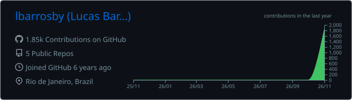
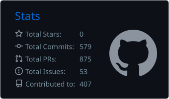
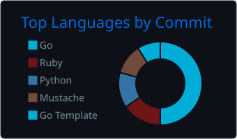

### Lucas Barros

Based in Rio de Janeiro. I design and operate Kubernetes platforms for teams that ship to production every day, mostly in financial services.

Over the last years that meant running a fleet of 330 clusters behind ArgoCD, Atlantis and Rancher, turning EKS provisioning from a two-day manual process into a 40-minute Terraform/Terragrunt pipeline, moving a 3,000 jobs/day Jenkins farm to immutable infrastructure, and treating cloud cost as an engineering metric rather than a finance report.

I care about boring, predictable infrastructure: everything in code, every change reviewed, upgrades that nobody notices.

**Open source**

Contributing upstream across the cloud native ecosystem: CNCF projects like Kubernetes, Envoy, Prometheus, Argo, Crossplane, Headlamp and CoreDNS, plus Terraform providers, Helm charts and AI infrastructure tooling (NVIDIA device plugin, Ray, deepwiki-open).

<!--START_SECTION:activity-->
      

☸️ **Merged into the Kubernetes core repository** ([kubernetes/kubernetes](https://github.com/kubernetes/kubernetes)): [cloud-provider: validate --concurrent-service-syncs](https://github.com/kubernetes/kubernetes/pull/143991) (2026-11-16 · approved by [@liggitt](https://github.com/liggitt))

**Merged** · official CNCF project repositories first · [see all 504 with filters](https://lbarrosby.github.io/lbarrosby/)

<b>Official CNCF Graduated projects</b> · 18 merged in 7 repos

| Project | Pull request | Merged | Merged by | Kind words |
|---|---|---|---|---|
|  [rook/rook](https://github.com/rook/rook) | [helm: pass mapOptions and unmapOptions to EC pool storage classes](https://github.com/rook/rook/pull/18854) | 2026-11-23 | [@travisn](https://github.com/travisn) |  |
|  [coredns/coredns](https://github.com/coredns/coredns) | [plugin/header: keep rules from every header block](https://github.com/coredns/coredns/pull/8746) | 2026-11-23 | [@mqasimsarfraz](https://github.com/mqasimsarfraz) | 🙏 [@mqasimsarfraz](https://github.com/coredns/coredns/pull/8746#pullrequestreview-5941853745): <i>"Thanks for addressing the comments, LGTM!"</i> |
|  [rook/rook](https://github.com/rook/rook) | [osd: requeue the disruption controller while a failure domain drains](https://github.com/rook/rook/pull/18752) | 2026-11-19 | [@sp98](https://github.com/sp98) |  |
|  [fluent/fluentd](https://github.com/fluent/fluentd) | [config: parse a fractional number before a size or time unit](https://github.com/fluent/fluentd/pull/5625) | 2026-11-19 | [@Watson1978](https://github.com/Watson1978) | 🙏 [@Watson1978](https://github.com/fluent/fluentd/pull/5625#pullrequestreview-5839800958): <i>"Thanks for the PR and the clear description."</i> |
|  [cert-manager/cert-manager](https://github.com/cert-manager/cert-manager) | [fix(pki): accept lowercase attribute type names in literalSubject](https://github.com/cert-manager/cert-manager/pull/9556) | 2026-11-17 | bot |  |
|  [rook/rook](https://github.com/rook/rook) | [helm: honor allowVolumeExpansion false on pool storage classes](https://github.com/rook/rook/pull/18802) | 2026-11-16 | [@travisn](https://github.com/travisn) |  |
|  [kubernetes/kubernetes](https://github.com/kubernetes/kubernetes) | [cloud-provider: validate --concurrent-service-syncs](https://github.com/kubernetes/kubernetes/pull/143991) | 2026-11-16 | bot |  |
|  [fluent/fluentd](https://github.com/fluent/fluentd) | [in_syslog: Treat a PRI above 191 as invalid](https://github.com/fluent/fluentd/pull/5635) | 2026-11-16 | [@Watson1978](https://github.com/Watson1978) | 🙏 [@Watson1978](https://github.com/fluent/fluentd/pull/5635#pullrequestreview-5913937246): <i>"Thanks for the fix."</i> |
|  [fluent/fluentd](https://github.com/fluent/fluentd) | [time: fix wrong %N/%L subseconds when EventTime and Integer times share a second](https://github.com/fluent/fluentd/pull/5634) | 2026-11-15 | [@Watson1978](https://github.com/Watson1978) | 🙏 [@Watson1978](https://github.com/fluent/fluentd/pull/5634#pullrequestreview-5884939807): <i>"Thanks for the clear report and the reproduction."</i> |
|  [rook/rook](https://github.com/rook/rook) | [helm: pass monitoring.metricsDisabled to the CephCluster](https://github.com/rook/rook/pull/18753) | 2026-11-13 | [@travisn](https://github.com/travisn) |  |
|  [rook/rook](https://github.com/rook/rook) | [helm: render CephBlockPool storage class labels as YAML](https://github.com/rook/rook/pull/18754) | 2026-11-13 | [@travisn](https://github.com/travisn) |  |
|  [kubernetes/cloud-provider-openstack](https://github.com/kubernetes/cloud-provider-openstack) | [[occm] Rename listener when its pool already has the new cluster-name](https://github.com/kubernetes/cloud-provider-openstack/pull/3283) | 2026-11-12 | bot |  |
|  [karmada-io/karmada](https://github.com/karmada-io/karmada) | [fix(resourceinterpreter): skip Ingress TLS entries without secretName in dependencies](https://github.com/karmada-io/karmada/pull/8029) | 2026-11-10 | [@karmada-bot](https://github.com/karmada-bot) | 🙏 [@zhzhuang-zju](https://github.com/karmada-io/karmada/pull/8029#issuecomment-6678810771): <i>"Thanks"</i> |
|  [fluent/fluentd](https://github.com/fluent/fluentd) | [in_tcp: fix inflated output emit_count when a message arrives in several reads](https://github.com/fluent/fluentd/pull/5608) | 2026-11-10 | [@Watson1978](https://github.com/Watson1978) | 🙏 [@Watson1978](https://github.com/fluent/fluentd/pull/5608#pullrequestreview-5835281054): <i>"Thanks!"</i> |
|  [coredns/coredns](https://github.com/coredns/coredns) | [plugin/acl: only add the EDE OPT record when the request has EDNS](https://github.com/coredns/coredns/pull/8749) | 2026-11-07 | [@yongtang](https://github.com/yongtang) |  |
|  [fluent/fluentd](https://github.com/fluent/fluentd) | [parser_syslog, in_syslog: fix handling of a priority on a later line](https://github.com/fluent/fluentd/pull/5598) | 2026-11-06 | [@Watson1978](https://github.com/Watson1978) | 🙏 [@Watson1978](https://github.com/fluent/fluentd/pull/5598#pullrequestreview-5795032353): <i>"Thanks!"</i> |
|  [fluent/fluentd](https://github.com/fluent/fluentd) | [record_accessor: raise ConfigError for a non-integer array index](https://github.com/fluent/fluentd/pull/5596) | 2026-11-06 | [@Watson1978](https://github.com/Watson1978) | 🙏 [@Watson1978](https://github.com/fluent/fluentd/pull/5596#pullrequestreview-5794474836): <i>"Thanks!"</i> |
|  [rook/rook](https://github.com/rook/rook) | [osd: don't wipe metadata devices of existing OSDs](https://github.com/rook/rook/pull/18686) | 2026-11-05 | [@arttor](https://github.com/arttor) | 🙏 [@arttor](https://github.com/rook/rook/pull/18686#pullrequestreview-5789316361): <i>"thanks for the fix."</i> |

<b>Official CNCF Incubating projects</b> · 7 merged in 3 repos

| Project | Pull request | Merged | Merged by | Kind words |
|---|---|---|---|---|
|  [lima-vm/lima](https://github.com/lima-vm/lima) | [downloader: don't leave a partial file at the local path](https://github.com/lima-vm/lima/pull/5751) | 2026-11-15 | [@jandubois](https://github.com/jandubois) | 🙏 [@jandubois](https://github.com/lima-vm/lima/pull/5751#pullrequestreview-5908833280): <i>"Thanks, LGTM"</i> |
|  [lima-vm/lima](https://github.com/lima-vm/lima) | [limatmpl: strip native arch aliases from image-derived instance names](https://github.com/lima-vm/lima/pull/5747) | 2026-11-15 | [@jandubois](https://github.com/jandubois) | 🙏 [@jandubois](https://github.com/lima-vm/lima/pull/5747#pullrequestreview-5908820167): <i>"Thanks, LGTM"</i> |
|  [opencost/opencost](https://github.com/opencost/opencost) | [fix(metrics): scale container_gpu_allocation on time-sliced and vGPU nodes](https://github.com/opencost/opencost/pull/4173) | 2026-11-13 | [@ameijer](https://github.com/ameijer) | 🙏 [@ameijer](https://github.com/opencost/opencost/pull/4173#pullrequestreview-5894171351): <i>"good catch!"</i> |
|  [opencost/opencost](https://github.com/opencost/opencost) | [fix(inferencecost): keep only grouped properties when aggregating](https://github.com/opencost/opencost/pull/4175) | 2026-11-10 | [@ameijer](https://github.com/ameijer) | 🙏 [@ameijer](https://github.com/opencost/opencost/pull/4175#pullrequestreview-5843570063): <i>"thank you cc @simanadler"</i> |
|  [projectcontour/contour](https://github.com/projectcontour/contour) | [Set alt_stat_name for DNS name clusters](https://github.com/projectcontour/contour/pull/7821) | 2026-11-09 | [@tsaarni](https://github.com/tsaarni) | 🙏 [@tsaarni](https://github.com/projectcontour/contour/pull/7821#pullrequestreview-5803527120): <i>"Thank you for contributing!"</i> |
|  [lima-vm/lima](https://github.com/lima-vm/lima) | [limactl edit: warn when changing the VM type of an existing instance](https://github.com/lima-vm/lima/pull/5743) | 2026-11-05 | [@AkihiroSuda](https://github.com/AkihiroSuda) |  |
|  [lima-vm/lima](https://github.com/lima-vm/lima) | [limayaml: don't panic when the latest config fails to load](https://github.com/lima-vm/lima/pull/5738) | 2026-11-05 | [@unsuman](https://github.com/unsuman) | 🙏 [@AkihiroSuda](https://github.com/lima-vm/lima/pull/5738#pullrequestreview-5784793825): <i>"Thanks"</i> |

<b>Official CNCF Sandbox projects</b> · 8 merged in 3 repos

| Project | Pull request | Merged | Merged by | Kind words |
|---|---|---|---|---|
|  [k8sgpt-ai/k8sgpt](https://github.com/k8sgpt-ai/k8sgpt) | [fix: declare the limit parameter on the MCP list-resources tool](https://github.com/k8sgpt-ai/k8sgpt/pull/1923) | 2026-11-19 | [@AlexsJones](https://github.com/AlexsJones) | 🙏 [@AlexsJones](https://github.com/k8sgpt-ai/k8sgpt/pull/1923#pullrequestreview-5810724055): <i>"Nice find, : the handler already binds limit, so this is the missing half rather than…"</i> |
|  [k8sgpt-ai/k8sgpt](https://github.com/k8sgpt-ai/k8sgpt) | [fix: require a namespace for namespaced kinds in MCP get-resource](https://github.com/k8sgpt-ai/k8sgpt/pull/1924) | 2026-11-17 | [@AlexsJones](https://github.com/AlexsJones) | 🙏 [@AlexsJones](https://github.com/k8sgpt-ai/k8sgpt/pull/1924#pullrequestreview-5810724210): <i>"Good catch, : a 404 that reads like 'the pod doesn't exist' is exactly the kind of…"</i> |
|  [kube-vip/kube-vip](https://github.com/kube-vip/kube-vip) | [fix(kubevip): write log level, on-demand election and egress backend into manifests](https://github.com/kube-vip/kube-vip/pull/1861) | 2026-11-17 | [@Cellebyte](https://github.com/Cellebyte) |  |
|  [kube-vip/kube-vip](https://github.com/kube-vip/kube-vip) | [fix(services): do not treat DHCP placeholder VIPs as shared](https://github.com/kube-vip/kube-vip/pull/1838) | 2026-11-09 | [@Cellebyte](https://github.com/Cellebyte) |  |
|  [kubernetes-sigs/headlamp](https://github.com/kubernetes-sigs/headlamp) | [backend: auth: Accept a single string groups claim in /me](https://github.com/kubernetes-sigs/headlamp/pull/8262) | 2026-11-05 | [@skoeva](https://github.com/skoeva) | 🙏 [@skoeva](https://github.com/kubernetes-sigs/headlamp/pull/8262#pullrequestreview-5785420953): <i>"lgtm, thanks"</i> |
|  [kubernetes-sigs/headlamp](https://github.com/kubernetes-sigs/headlamp) | [frontend: resourceMap: Resolve HTTPRoute parent and backend refs](https://github.com/kubernetes-sigs/headlamp/pull/8254) | 2026-11-04 | [@skoeva](https://github.com/skoeva) |  |
|  [kubernetes-sigs/headlamp](https://github.com/kubernetes-sigs/headlamp) | [frontend: util: Use desired DaemonSet pods as the total](https://github.com/kubernetes-sigs/headlamp/pull/8259) | 2026-11-04 | [@skoeva](https://github.com/skoeva) |  |
|  [kubernetes-sigs/headlamp](https://github.com/kubernetes-sigs/headlamp) | [frontend: resourceMap: Match NetworkPolicy podSelector fully](https://github.com/kubernetes-sigs/headlamp/pull/8245) | 2026-11-04 | [@skoeva](https://github.com/skoeva) |  |

<b>Latest merges elsewhere</b> · 15 most recent of 471 (ecosystem, Terraform providers, Helm charts, tools)

| Project | Pull request | Merged | Merged by | Kind words |
|---|---|---|---|---|
| [fluent-plugins-nursery/fluent-plugin-kubernetes_metadata_filter](https://github.com/fluent-plugins-nursery/fluent-plugin-kubernetes_metadata_filter) | [Add container image metadata to init container logs](https://github.com/fluent-plugins-nursery/fluent-plugin-kubernetes_metadata_filter/pull/445) | 2026-11-25 | [@Watson1978](https://github.com/Watson1978) | 🙏 [@Watson1978](https://github.com/fluent-plugins-nursery/fluent-plugin-kubernetes_metadata_filter/pull/445#pullrequestreview-6010597854): <i>"Thanks for the PR."</i> |
| [fluent-plugins-nursery/fluent-plugin-out-http](https://github.com/fluent-plugins-nursery/fluent-plugin-out-http) | [Fix empty text bodies and double-encoded JSON for formatted records](https://github.com/fluent-plugins-nursery/fluent-plugin-out-http/pull/99) | 2026-11-25 | [@Watson1978](https://github.com/Watson1978) | 🙏 [@Watson1978](https://github.com/fluent-plugins-nursery/fluent-plugin-out-http/pull/99#pullrequestreview-5934583301): <i>"Thanks for the fix."</i> |
|  [fluent/fluent-plugin-opensearch](https://github.com/fluent/fluent-plugin-opensearch) | [out_opensearch_data_stream: honor pipeline](https://github.com/fluent/fluent-plugin-opensearch/pull/205) | 2026-11-25 | [@Watson1978](https://github.com/Watson1978) | 🙏 [@Watson1978](https://github.com/fluent/fluent-plugin-opensearch/pull/205#pullrequestreview-5857345114): <i>"Thanks for the fix."</i> |
|  [fluent/fluent-plugin-opensearch](https://github.com/fluent/fluent-plugin-opensearch) | [out_opensearch,in_opensearch: ignore spaces around commas in hosts](https://github.com/fluent/fluent-plugin-opensearch/pull/210) | 2026-11-25 | [@Watson1978](https://github.com/Watson1978) | 🙏 [@Watson1978](https://github.com/fluent/fluent-plugin-opensearch/pull/210#pullrequestreview-6010679466): <i>"Thanks for the fix."</i> |
| [fluent-plugins-nursery/fluent-plugin-out-http](https://github.com/fluent-plugins-nursery/fluent-plugin-out-http) | [Honor NO_PROXY when a proxy environment variable is set](https://github.com/fluent-plugins-nursery/fluent-plugin-out-http/pull/98) | 2026-11-25 | [@Watson1978](https://github.com/Watson1978) | 🙏 [@Watson1978](https://github.com/fluent-plugins-nursery/fluent-plugin-out-http/pull/98#pullrequestreview-5856183899): <i>"Thanks for working on this."</i> |
| [fluent-plugins-nursery/fluent-plugin-cloudwatch-logs](https://github.com/fluent-plugins-nursery/fluent-plugin-cloudwatch-logs) | [Use the event timestamp when the parser gives no time](https://github.com/fluent-plugins-nursery/fluent-plugin-cloudwatch-logs/pull/312) | 2026-11-25 | [@Watson1978](https://github.com/Watson1978) | 🙏 [@Watson1978](https://github.com/fluent-plugins-nursery/fluent-plugin-cloudwatch-logs/pull/312#pullrequestreview-6010593695): <i>"Thank you for the fix."</i> |
| [fluent-plugins-nursery/fluent-plugin-bigquery](https://github.com/fluent-plugins-nursery/fluent-plugin-bigquery) | [out_bigquery_insert: Keep other queued chunks on a non-retryable error without a <secondary>](https://github.com/fluent-plugins-nursery/fluent-plugin-bigquery/pull/236) | 2026-11-25 | [@Watson1978](https://github.com/Watson1978) | 🙏 [@Watson1978](https://github.com/fluent-plugins-nursery/fluent-plugin-bigquery/pull/236#pullrequestreview-6010586393): <i>"Thanks for the fix."</i> |
| [fluent-plugins-nursery/fluent-plugin-bigquery](https://github.com/fluent-plugins-nursery/fluent-plugin-bigquery) | [out_bigquery_load: Give up only the failed chunk on a non-retryable error](https://github.com/fluent-plugins-nursery/fluent-plugin-bigquery/pull/235) | 2026-11-25 | [@Watson1978](https://github.com/Watson1978) | 🙏 [@Watson1978](https://github.com/fluent-plugins-nursery/fluent-plugin-bigquery/pull/235#pullrequestreview-6010581358): <i>"Thanks for the fix and the tests."</i> |
| [kokuwaio/helm-charts](https://github.com/kokuwaio/helm-charts) | [fix(mysqldump): fail the backup job when mysqldump fails](https://github.com/kokuwaio/helm-charts/pull/269) | 2026-11-24 | [@monotek](https://github.com/monotek) |  |
| [latitudesh/terraform-provider-latitudesh](https://github.com/latitudesh/terraform-provider-latitudesh) | [fix: remove server, ssh_key, user_data and firewall from state when deleted outside Terraform](https://github.com/latitudesh/terraform-provider-latitudesh/pull/263) | 2026-11-24 | [@LanusseMorais](https://github.com/LanusseMorais) |  |
| [latitudesh/terraform-provider-latitudesh](https://github.com/latitudesh/terraform-provider-latitudesh) | [fix(project): read the project by ID instead of scanning the first page](https://github.com/latitudesh/terraform-provider-latitudesh/pull/264) | 2026-11-24 | [@LanusseMorais](https://github.com/LanusseMorais) |  |
| [czerwonk/junos_exporter](https://github.com/czerwonk/junos_exporter) | [fix: read PEM current from str3-dc-current on newer Junos](https://github.com/czerwonk/junos_exporter/pull/410) | 2026-11-24 | [@czerwonk](https://github.com/czerwonk) |  |
| [czerwonk/junos_exporter](https://github.com/czerwonk/junos_exporter) | [fix(security): skip N/A central point session counters](https://github.com/czerwonk/junos_exporter/pull/411) | 2026-11-24 | [@czerwonk](https://github.com/czerwonk) |  |
| [spacelift-io/terraform-provider-spacelift](https://github.com/spacelift-io/terraform-provider-spacelift) | [fix(stack_destructor, stack_activator): import by stack ID](https://github.com/spacelift-io/terraform-provider-spacelift/pull/882) | 2026-11-24 | [@mbialon](https://github.com/mbialon) |  |
| [pengovbr/mod-wssei](https://github.com/pengovbr/mod-wssei) | [docs: documenta a assinatura de documentos sem bloco no swagger](https://github.com/pengovbr/mod-wssei/pull/143) | 2026-11-24 | [@caduvieira](https://github.com/caduvieira) |  |

[All 471 of them, with filters](https://lbarrosby.github.io/lbarrosby/)

**In review** · 404 open pull requests · [browse and filter](https://lbarrosby.github.io/lbarrosby/)

- Official CNCF Graduated: 31 in 15 repos
- Official CNCF Incubating: 7 in 4 repos
- Official CNCF Sandbox: 13 in 5 repos
- CNCF ecosystem: 121 in 62 repos
- Other: 232 in 143 repos

<!--END_SECTION:activity-->

**Projects**

- [helm-charts](https://github.com/lbarrosby/helm-charts): production-ready Helm charts with secure defaults, Gateway API, HPA/KEDA and schema-validated values, tested and released from CI
- [terraform-aws-platform](https://github.com/lbarrosby/terraform-aws-platform): opinionated Terraform modules for EKS platforms (VPC, EKS with access entries and Pod Identity, Karpenter), tested with mock providers and laid out for Terragrunt

 

 

**Certifications**

**Platform** &nbsp;

**Delivery** &nbsp;

**Observability** &nbsp;

**Cloud & code** &nbsp;

 

  

  
  
  

<picture>
  <source media="(prefers-color-scheme: dark)" srcset="https://raw.githubusercontent.com/lbarrosby/lbarrosby/output/github-contribution-grid-snake-dark.svg">
  
</picture>
